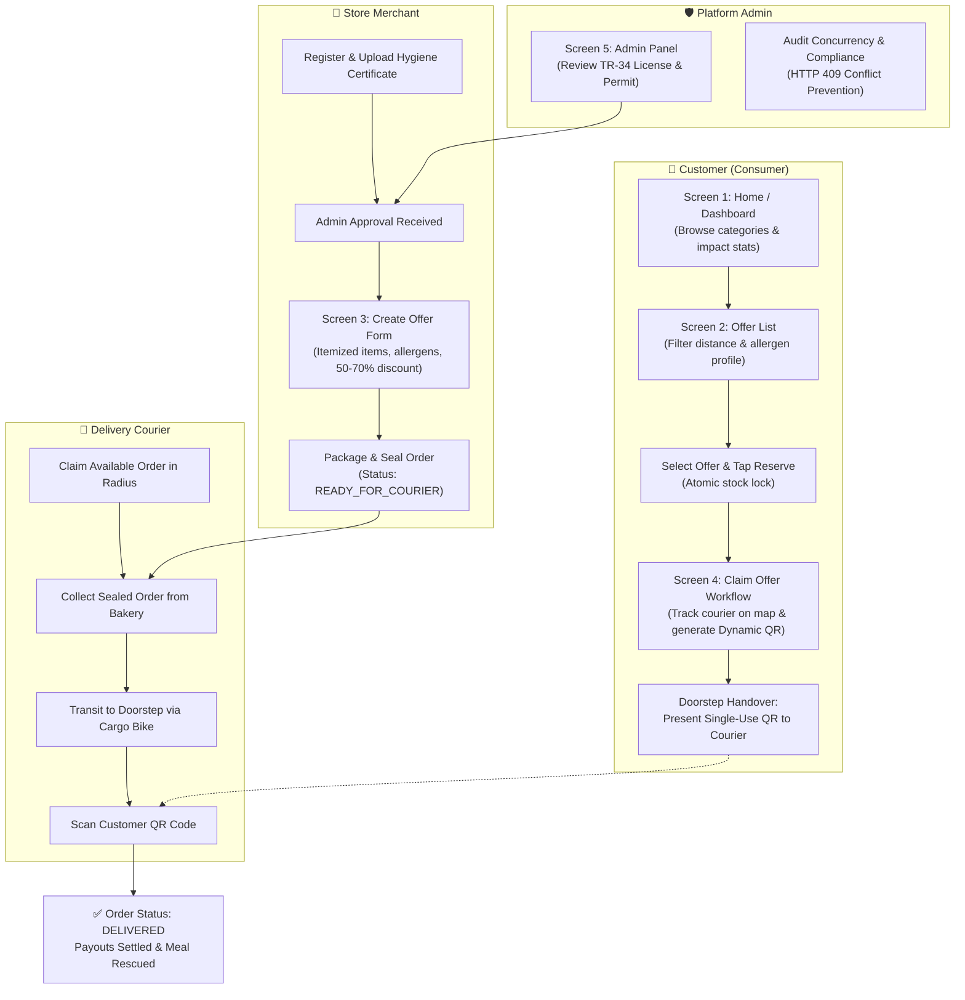

# 🎨 RescueBite UI/UX Prototypes & User-Flow Specifications (Sprint 2 - Task B4)

> **Assigned Engineer:** Muhammed Fatih Ağaç (Implementation & Integration Engineer)  
> **Course:** SENG 321 - Software Engineering Project  
> **Project:** Neighborhood Surplus Food Market (*RescueBite*)  
> **Figma Project Name:** `RescueBite UI`  
> **Interactive Figma Link (View Only):** [https://www.figma.com/design/YqnIJn9K1PqsI2ZgTn2QHu/RescueBite-UI?node-id=0-1&t=RQDhqyHRI2qhTiVm-1](https://www.figma.com/design/YqnIJn9K1PqsI2ZgTn2QHu/RescueBite-UI?node-id=0-1&t=RQDhqyHRI2qhTiVm-1)

---

## 📱 Designed High-Fidelity Screens & Deliverables Index

All production high-resolution screen exports have been generated and archived in `docs/sprint2/design/`:

| Screen # | Screen Name | Target Persona / Actor | Purpose & Key Features | High-Res Export |
|---|---|---|---|---|
| **01** | **Home / Dashboard** | Consumer / General | Hero banner with waste reduction KPIs (14,820+ meals saved), location picker (Kadıköy/Moda), search bar, category filter pills, transparent surplus promise bar, active deals carousel. | [`Home.png`](Home.png) |
| **02** | **Offer List** | Consumer / Customer | Radius slider (1.5km - 5km), allergen exclusion filter (Vegan, Nut-Free, Gluten-Free), transparent itemized cards, discount indicators (-64%), live Kadıköy map view with courier proximity pins. | [`OfferList.png`](OfferList.png) |
| **03** | **Create Offer (Form)** | Store Merchant (Bakery / Cafe) | Multi-step merchant wizard (<90 sec listing), mandatory transparent item breakdown (strictly no mystery bags), pricing calculator (discount % and savings), consumption deadline, allergen profile tags, hygiene warranty. | [`CreateOffer.png`](CreateOffer.png) |
| **04** | **Claim Offer (Workflow)** | Customer & Courier | Multi-step delivery workflow: payment reservation, atomic lock verification, store preparation, live bike courier tracking, itemized receipt, and **dynamic single-use cryptographic QR code** (refreshes every 60s) for doorstep handover. | [`ClaimOffer.png`](ClaimOffer.png) |
| **05** | **Admin Governance Panel** | Platform Administrator | Food hygiene license queue (`updateStoreApproval`), municipal permits, merchant vetting, real-time safety audit stream, atomic concurrency guard monitoring (HTTP 409 conflict handling). | [`AdminPanel.png`](AdminPanel.png) |
| **06** | **User-Flow Diagram** | System Architect / Developers | Complete swimlane interaction map connecting Store, Customer, Courier, and Admin across all 5 prototype screens from offer creation to doorstep QR handover. | [`Flow.png`](Flow.png) / [`UserFlow.png`](UserFlow.png) |

---

## 🔄 User-Flow & Prototype Interaction Map

---

## 🎨 Design System & Visual Guidelines

- **Primary Color:** `#10B981` (Emerald Green - Freshness, Sustainability, Trust)
- **Secondary / Action Accent:** `#0F172A` (Slate Dark - Contrast, High Readability)
- **Warning / Urgency Accent:** `#EF4444` / `#F59E0B` (Countdown timers & High Discounts)
- **Backgrounds:** `#F8FAFC` (Canvas), `#FFFFFF` (Cards & Modals)
- **Typography:** Inter / System Font Stack (-apple-system, Segoe UI, Roboto)
- **Accessibility:** Meets WCAG AA contrast standards; distinct visual badges for all 8 major allergen categories.
- **Core Principle:** **100% Itemized Transparency** (strict prohibition of mystery packages or unannounced food items).
